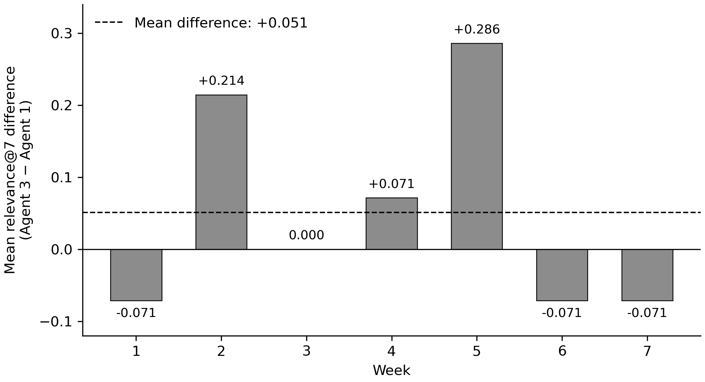

# M3: Comparing research-digest agents

## From M2 to three agents

Our task is to select papers that a researcher would want to read. Titles and abstracts often provide enough information for that decision. Detailed inspection is useful when it resolves uncertainty about personal relevance. Finding code is less useful unless implementation availability is an explicit preference.

During development, the M2-style agent made only five tool calls across three top-10 selection runs, all to `inspect_paper`. With `gpt-5.6-luna`, we also observed a two-week digest run with only one tool call. We tried changing its prompt to encourage it to call tools, but it didn't help. We switched to `gpt-6-sol`, which explored more actively in our runs. All agents in the final comparison used `gpt-6-sol` through Codex CLI 0.169.0.

| Agent | Design | Hypothesis |
| --- | --- | --- |
| 1: ReAct | BM25 top 30 → batch screening → tool/finish loop. Retains the M2 architecture after shared harness fixes. | Abstract screening plus optional retrieval is sufficient for a useful digest. |
| 2: Exploration | BM25 top 200 → E5 similarity ranking → top 30 → screening → ReAct with candidate overview, similar-paper search, and one selection check. | Better initial retrieval and feedback before stopping recover overlooked papers. |
| 3: Debate | Same initial retrieval as Agent 2 → screening → independent precision and coverage reviewers → editor-controlled tool/reconsideration/finish loop. | Separating precision and coverage judgments helps resolve ambiguous profile matches. |

Agent 1 has `inspect_paper`, `search_candidates`, `expand_shortlist`, `find_code`, and optional `analyze_twitter`. Agents 2 and 3 add `get_candidate_overview` and `search_similar`. X analysis was disabled for evaluation.

**Agent 2: improve candidate discovery and reconsider stopping.** Our first concern was that the agent could make a reasonable selection from an incomplete shortlist. In the 100-paper development sample, BM25's first 30 contained only 10 of the 15 interesting papers. Inspecting those candidates more deeply would not expose the other five. We therefore focused on finding better candidates rather than requiring more inspection calls. We added `get_candidate_overview` to expose unseen counts and topic coverage, and `search_similar(paper_id)` to search the remaining corpus from a promising screened paper. We also reranked BM25's top 200 against the profile using `intfloat/e5-small-v2`, then passed the top 30 to screening. In development, this raised the shortlist's interesting-paper count from 10 to 12 and its potentially interesting count from 4 to 6. A second concern came from runs that finished after very little exploration: the model had retrieval tools but did not necessarily reconsider whether better candidates remained. We added one selection check at the first valid `finish`, using the draft, profile, screened candidates, and a cheap Python overview. It can accept, request revision, or request retrieval. After feedback, the next valid finish is accepted to prevent repeated review loops. Our hypothesis was that this would help on tasks with weak initial matches or relevant papers outside the first shortlist. The expected trace change is a `search_candidates` or `search_similar` action, possibly triggered by the selection check, followed by a better replacement in the final digest. 

**Agent 3: separate judgments about precision and coverage.** M2's evaluation contained both irrelevant selections and a missed relevant paper. Together with the observation that abstracts often suffice for deciding personal interest, this suggested a different question: could we improve how the agent weighs the available candidates, without assuming that deeper investigation is always needed? A single selector has to reject loose matches while also recognizing less obvious connections to the profile. We made those responsibilities explicit. A precision reviewer challenges weak matches and conflicts with the researcher's preferences. A coverage reviewer looks for valuable candidates that might be overlooked, without requiring every profile topic to appear. They first assess the same pool independently so that one does not simply follow the other's answer. Python identifies disagreements, and an editor resolves them against the profile. The editor retains the tool/finish loop and can request one targeted reconsideration per reviewer. It replaces Agent 2's final selection check while retaining its retrieval setup. Our hypothesis was that this would help on ambiguous relevance decisions, particularly when a paper matches a secondary interest but competes with a stronger core-interest paper. The expected trace evidence is a disputed inclusion or omission, followed by an editor decision to retain or replace that candidate with a profile-based explanation.

Shared fixes included clearer separation of prohibited Codex-native tools from permitted application actions. Exact quote-matching checks were removed after repeated repair loops. Structural checks and the requested paper count remain enforced. Agent 1 therefore represents the corrected M2 architecture.


We measured context length across multiple runs requesting 15-paper digests for a two-week period. Agent 2’s initial runs peaked at 98,458–100,632 characters per call. With `gpt-6-sol`, the measured peaks were 176,531 characters for Agent 1, 375,024 for Agent 2, and 141,135 for Agent 3. The largest Agent 2 run reported a maximum of 91,349 input tokens in one call and completed successfully. Character counts include harness instructions, payload, and schema, but exclude CLI-internal overhead. We observed no context-length failures in these runs, so we retained the existing approach without summarization or compaction. This supports that choice for the tested workload, not for arbitrarily long runs. See the saved context summaries for [Agent 1](../data/runs/react-gpt6-sol-15-20261117/context-summary.json), [Agent 2](../data/runs/react-explore-gpt6-sol-updated-15-20261117/context-summary.json), and [Agent 3](../data/runs/debate-gpt6-sol-15-20261117/usage-summary.json).

## Development sample: 100 papers

We combined 12 verified AlphaXiv liked papers with 88 papers from cached arXiv metadata, distributed across ten topic groups using seed `20261117`. This was a stratified convenience sample, not a random sample of ML research. Dmitrii manually rated every paper:

| Rating | Meaning | Papers |
| --- | --- | ---: |
| 0 | Not interesting | 69 |
| 0.5 | Potentially interesting | 16 |
| 1 | Interesting | 15 |

We used this sample to diagnose retrieval, stopping, and selection problems and develop the variants. It is development data, not independent test evidence. See [sample construction](../labeling/build_sample.py) and [labels](../labeling/labeled_sample.json).

## Weekly test construction

We froze seven completed Monday–Sunday windows: **28 September–15 November 2026**, using UTC initial submission dates and categories `cs.LG`, `cs.CL`, `stat.ML`, `cs.AI`, and `cs.IR`. The corpora contain **21,006 papers** in total.

```text
Seven frozen weekly corpora + one fixed researcher profile
    ├─ BM25 → top 7
    ├─ BM25 top 200 → E5 → top 7
    ├─ Agent 1 → 7 papers
    ├─ Agent 2 → 7 papers
    └─ Agent 3 → 7 papers
                 ↓
       Pool, deduplicate, shuffle
                 ↓
       Blind human relevance labels
```

Each system ran once per week. All 35 digests completed with exactly seven papers. Their pooled selections contained **122 distinct papers**, rated in a local website with system identities, ranks, and recommendation reasons hidden. Final labels were **45 not interesting, 45 potentially interesting, and 32 interesting**.

Dates, profile, metadata versions, model, source hashes, ordering seed (`20261118`), and traces were saved. External tool responses were captured on first use and replayed across systems. They were not all frozen before execution. Agent budgets were unlimited. The requested dates overlap earlier development activity, and two pooled papers had previous labels, so this is not a pristine holdout.

## Measurement and results

The primary metric is **mean relevance@7**: sum the seven human ratings and divide by seven, then average across weeks. We also report the fraction rated interesting and execution completion. No LLM judge was used. Full-corpus recall cannot be measured because only pooled selections were labeled.

| System | Mean relevance@7 | Approx. 95% CI | Interesting selections | Uninteresting selections | Completed tasks |
| --- | ---: | --- | ---: | ---: | ---: |
| BM25 | 0.490 | [0.306, 0.653] | 14/49 (28.6%) | 15/49 | 7/7 |
| E5 | 0.469 | [0.388, 0.571] | 13/49 (26.5%) | 16/49 | 7/7 |
| Agent 1 | 0.551 | [0.408, 0.694] | 17/49 (34.7%) | 12/49 | 7/7 |
| Agent 2 | 0.571 | [0.469, 0.673] | 17/49 (34.7%) | 10/49 | 7/7 |
| Agent 3 | 0.602 | [0.490, 0.704] | 18/49 (36.7%) | 8/49 | 7/7 |

Mean resources per weekly task, including screening and reviewer/check calls:

| System | Decision steps | LLM calls | Tool calls | Input tokens | Output tokens | Latency | $/task |
| --- | ---: | ---: | ---: | ---: | ---: | ---: | --- |
| BM25 | 0 | 0 | 0 | 0 | 0 | ~0.10 s | No LLM charge, compute unpriced |
| E5 | 0 | 0 | 0 | 0 | 0 | ~7.78 s | No LLM charge, local inference unpriced |
| Agent 1 | 14.43 | 22.57 | 13.43 | 1,057,336 | 10,881 | 354.6 s | $2.22 |
| Agent 2 | 18.00 | 25.00 | 15.00 | 1,086,080 | 12,419 | 385.4 s | $2.30 |
| Agent 3 | 17.00 | 23.86 | 14.00 | 1,033,465 | 14,192 | 412.8 s | $2.21 |

BM25 averaged 0.10 s across three ranking replays per week on the local ARM64 Mac. E5 adds the original CPU reranking time (7.68 s on average, including model loading) to BM25, giving 7.78 s. These timings exclude fetching and arxiv corpus loading. See [timings](../eval/runs/weekly-20261118/analysis/baseline-latency.json) and the [benchmark script](../eval/runs/weekly-20261118/analysis/benchmark_baselines.py).

Baseline token counts refer to generative LLM calls. Agent latency excludes shared corpus collection and initial ranking and was measured with concurrent jobs. API-equivalent costs use [current GPT-6 Sol Standard prices](https://developers.openai.com/api/docs/models/gpt-6-sol), checked 18 November 2026: $2/M input tokens and $10/M output tokens. We assume all input is uncached and exclude cache writes, regional premiums, external tools, and local compute. Cost is $(2N_{in} + 10N_{out})/10^6$ per task. The largest individual call contained 135,996 input tokens, below the 272K threshold for higher pricing. The 21 agent runs total approximately $47.10.  See [per-run calculations](../eval/runs/weekly-20261118/analysis/api-cost-estimate.json).

## Uncertainty and interpretation

Agent 3 had the highest average relevance score, but seven weeks provide limited evidence that it would consistently outperform the other systems.

To estimate uncertainty, we repeatedly formed seven-week samples from the observed weeks, allowing a week to appear more than once, and recalculated the average scores and differences. The middle 95% of these bootstrap results gives the approximate intervals reported above. We evaluated all $7^7$ possible ordered samples. Agent 3's improvement over Agent 1 was **0.051**, with a paired 95% interval of **[-0.041, 0.153]**. The interval includes both a small disadvantage and an advantage, so the direction of the difference remains uncertain.

These estimates assume independent, comparable weeks. Adjacent weeks may be related, and one run per agent per week does not separately measure model randomness. We would provisionally choose Agent 3 based on its observed relevance scores, but we cannot claim a statistically reliable winner. The evaluation reflects one researcher's preferences.

### Weekly wins, ties, and losses

We compared mean relevance@7 within each week. A win means the first agent scored higher, and a tie means equal scores, even if the selected papers differed.

| Comparison | Wins | Ties | Losses |
| --- | ---: | ---: | ---: |
| Agent 2 vs Agent 1 | 3 | 2 | 2 |
| Agent 3 vs Agent 1 | 3 | 1 | 3 |
| Agent 3 vs Agent 2 | 3 | 2 | 2 |



*Figure 1. Weekly difference in mean relevance@7 between Agent 3 and Agent 1. The dashed line shows the average difference across seven weeks.*

Agent 3 won and lost equally often against Agent 1. Its higher average came from larger gains in its winning weeks: +0.214, +0.071, and +0.286, compared with three losses of 0.071 each. The strongest gains occurred in weeks 2 and 5. This supports a provisional preference based on average relevance, but not a claim that Agent 3 usually wins. 

Source: [weekly scores](../eval/runs/weekly-20261118/analysis/core-label-revision/weekly-scores.csv). The [figure script](../eval/runs/weekly-20261118/analysis/plot_weekly_comparisons.py) reproduces the comparison counts and figure.

### Repeated runs on a 1,000-paper corpus

We kept all 122 weekly human-labeled papers (32 interesting, 45 potentially interesting, 45 not interesting) and sampled 878 distinct papers from the saved seven-week arXiv corpus, using seed `2026111801`. The additional papers were assigned zero as assumed negatives. The frozen corpus, profile, source snapshot, and labels were saved. Each agent ran 10 times on the same corpus with `gpt-6-sol`, fresh screening and run state, a 30-paper initial shortlist, and an exact 10-paper digest. Tool responses were shared through cached/first-use fixtures.

| Agent | Interesting in top 30 (of 32) | Interesting or potential in top 30 (of 77) | Completed | Mean relevance@10 ± SD | Min–max | Mean selection overlap |
| --- | ---: | ---: | ---: | --- | --- | ---: |
| Agent 1 | 11/32 (34.4%) | 20/77 (26.0%) | 10/10 | 0.810 ± 0.032 | 0.750–0.850 | 74.2% |
| Agent 2 | 9/32 (28.1%) | 22/77 (28.6%) | 10/10 | 0.820 ± 0.054 | 0.700–0.900 | 68.4% |
| Agent 3 | 9/32 (28.1%) | 22/77 (28.6%) | 9/10 | 0.744 ± 0.058 | 0.650–0.850 | 68.1% |

Agent 2 had the highest mean relevance on this corpus (0.820), narrowly ahead of Agent 1 (0.810). The 0.010 difference is small relative to their run-to-run SDs. Agent 1 retained the most stable selections. Agent 3 averaged 0.744 across successful runs, and one run failed because a reviewer did not assess every supplied candidate. No completed digest selected any of the 878 assumed-negative papers, so final relevance scores depend entirely on human labels. These results show that the preferred design depends on the candidate pool.

Coverage is measured before LLM screening and is fixed across repetitions: Agent 1 uses BM25, while Agents 2 and 3 use E5 reranking of the BM25 top 200. SD measures run-to-run variation on this one corpus. 

[Frozen dataset](../eval/runs/repeated-1000-20261118/sample.json) · [Per-run results and coverage](../eval/runs/repeated-1000-20261118/analysis-core-label-revision.json) · [Configuration and source hashes](../eval/runs/repeated-1000-20261118/manifest.json). Reproduce with `python -m eval.run_repeated` from the project environment.

## Reproducibility and assessment scope

- [Run manifest](../eval/runs/weekly-20261118/manifest.json): dates, configuration, source hashes, and protocol.
- [Fixed ratings](../eval/runs/weekly-20261118/analysis/core-label-revision/labeled-sample.json), [weekly scores](../eval/runs/weekly-20261118/analysis/core-label-revision/weekly-scores.csv), and [pairwise statistics](../eval/runs/weekly-20261118/analysis/core-label-revision/results.json).
- [Execution summary](../eval/runs/weekly-20261118/execution-summary.json) and [run directory](../eval/runs/weekly-20261118/): preserved per-agent traces and model calls.

Recompute the analysis from the repository root without new model calls:

```bash
conda activate ai-research-digest
python -m eval.recalculate_core_label
```

The assessment asks for M2 plus three variants on the original frozen M2 sample using its evaluation method. This report compares **three agents total plus two retrieval baselines** on a new weekly selection task. 

## Appendix A: Agent pipelines

All agents use the same researcher profile and weekly corpus. Screening assigns relevance labels and reasons to candidates. Tool observations return to the deciding model. In this evaluation, the requested digest size was seven.

### Agent 1: ReAct

```text
Profile + categories + dates
             |
             v
Fetch arXiv metadata -> deduplicate/store in SQLite
             |
             v
BM25 ranks corpus -> top 30 -> LLM batch screening
             |
             v
      Main LLM chooses action <----------------------+
             |                                      |
       +-----+------+                               |
       |            |                               |
    Use tool      Finish                            |
       |            |                               |
       v            v                               |
  Observation   Validate structure + paper count     |
       |            |                               |
       |       +----+----+                          |
       |       |         |                          |
       |     Valid     Invalid -> feedback ---------+
       |       |                                    |
       +-------|------------------------------------+
               v
        Save/display digest
```

Tools: `inspect_paper`, `search_candidates`, `expand_shortlist`, `find_code`, and optional `analyze_twitter` (disabled here).

### Agent 2: Exploration and selection check

```text
Profile + categories + dates
             |
             v
Fetch metadata -> SQLite -> BM25 top 200
             |
             v
E5 similarity to profile -> top 30 -> LLM batch screening
             |
             v
      Main LLM chooses action <--------------------------+
             |                                          |
       +-----+------+                                   |
       |            |                                   |
    Use tool      Finish                                |
       |            |                                   |
       v            v                                   |
  Observation   Validate digest                         |
       |            |                                   |
       +------------|-----------------------------------+
                    |                                   |
             Invalid -> feedback -----------------------+
                    |                                   |
                  Valid                                 |
                    |                                   |
           Selection check already done?                |
              /                \                        |
            Yes                No                       |
             |                  |                       |
             |         Python candidate overview        |
             |                  |                       |
             |         One LLM selection check          |
             |            /     |      \                |
             |         Accept Revise  Search            |
             |            |     |       |               |
             |            |  Feedback   Retrieval tool  |
             |            |     |       |               |
             |            |     +-------+---------------+
             v            v
             Save/display digest
```

Tools: all Agent 1 tools plus `get_candidate_overview` and `search_similar`. The check receives the draft, profile, candidate summaries, overview, and remaining budgets. After its feedback, the next valid finish is saved without another check.

### Agent 3: Independent reviewers and an editor

```text
Profile + categories + dates
             |
             v
Fetch metadata -> SQLite -> BM25 top 200
             |
             v
E5 similarity to profile -> top 30 -> LLM batch screening
             |
             v
    Same profile and screened candidates
             |
       +-----+------------------+
       |                        |
       v                        v
Precision reviewer       Coverage reviewer
Challenge weak matches   Find overlooked relevance
       |                        |
       +------------+-----------+
                    |
                    v
        Python identifies disagreements
                    |
                    v
         Editor chooses action <------------------------+
                    |                                   |
          +---------+-------------+                     |
          |         |             |                     |
       Use tool  Ask reviewer   Finish                  |
          |         |             |                     |
          v         v             v                     |
     Observation  Targeted    Validate digest           |
          |       judgment        |                     |
          |         |        +----+----+                |
          |         |        |         |                |
          |         |      Valid     Invalid -> feedback+
          |         |        |                          |
          +---------+--------|--------------------------+
                             v
                      Save/display digest
```

The initial reviewers do not see each other's answers. The editor has Agent 2's tools and can request one reconsideration per reviewer. It controls retrieval and stopping. There is no additional selection check after its valid finish.
